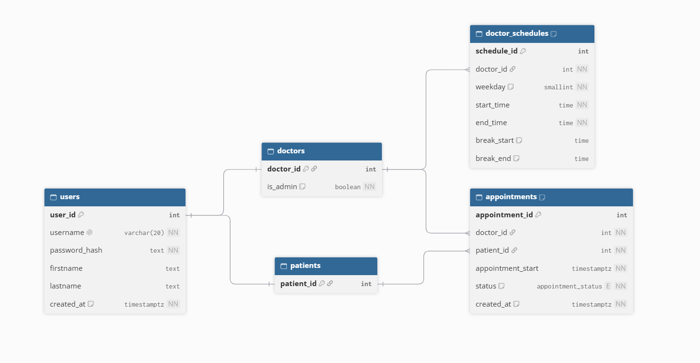

# Appointment Management System - Savannah Informatics Limited

## Initial Considerations

I started by deriving functional and non-functional requirements from the problem statement. Doing this first let me state my assumptions explicitly and gave the rest of the design a solid foundation.

### Assumptions

- Each appointment occupies exactly one time slot.
- Doctors can schedule breaks as needed, capped at one hour.
- Schedules may differ between working days.
- All staff who operate the system are doctors.
- Leave is approved by an administrator.
- Payment integration is out of scope.

### Functional Requirements

1. Doctor management:
    - Doctors can set their own working hours for each day of the week.
    - Doctors can define their own break times.
    - Appointment slots must not overlap with each other or with break times.
1. Patient appointment booking:
    - Patients can view a doctor's availability.
    - Patients can book a specific slot with a doctor.
    - Patients can cancel their own appointments at any time.
    - Two patients cannot book the same doctor for the same slot.
    - The system distinguishes missed appointments from completed ones.
1. Account management:
    - Administrators can create staff (doctor) accounts.
    - Administrators can delete any account.
    - Administrators can record leaves of absence for any doctor.
    - Patients can create their own accounts.

### Non-Functional Requirements

1. The application should have low latency.
1. Test coverage must be broad and cover all functional requirements.

## System Design

With the requirements settled, I moved on to design. Before choosing any technology, I defined the schema.

### Entity Relationships

The requirements imply two types of users: patients and doctors. The two overlap significantly, since both need biographical and identifying information for security and authentication. The schema therefore has a `users` table for the shared fields, and its primary key identifies the user in the `patients` and `doctors` tables.

The `doctors` table has a flag marking administrators, who can perform user management. Its `doctor_id` field is a foreign key in two tables:

- `doctor_schedules`, which tracks each doctor's workdays and working hours.
- `doctor_time_off`, which tracks when a doctor is unavailable.

The `appointments` table is the associative entity between doctors and patients.

At the database level, I planned constraints to prevent double bookings. Enforcing this in the database avoids race conditions when two patients book the same doctor at the same moment. A second constraint ensures each doctor has only one schedule per weekday.
